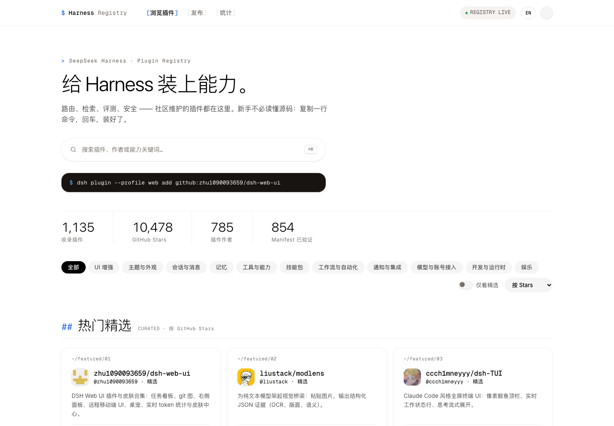

# Harness Registry — DeepSeek Harness Plugin Registry

Harness Registry is a searchable DeepSeek Harness plugin registry for DSH users and plugin authors. It combines a community-curated catalog with GitHub discovery, verifies the installable `dsh.bundle` manifest contract, and exposes comparable plugin metadata and copy-ready install commands.

> Status: pre-release. The registry is available at [plugin.dshdesk.com](https://plugin.dshdesk.com/) and the source is released under the MIT License. See [launch readiness](docs/shipwise-readiness.md).



## Quickstart

Requirements: Node.js 22 and npm.

```bash
git clone https://github.com/majiayu000/dsh-plugin-registry.git
cd dsh-plugin-registry
npm ci
npm run dev
```

Open <http://localhost:5173> to browse, search, filter, and inspect the registry.

## What it provides

- A searchable web directory with categories, trust labels, Stars, Forks, and install commands.
- Curated entries vendored from the community catalog into [`sources/curated.json`](sources/curated.json).
- Automatic discovery from the GitHub `dsh-plugin` topic and the community catalog at `https://awesome-dsh-plugin.com/plugins.json`.
- Manifest verification: discovered repositories must declare a valid `dsh.bundle` object in `package.json`, and its referenced patch file must exist.
- Supply-chain pinning: each verified plugin records the exact `verifiedCommit` HEAD its manifest was checked against.
- A public JSON snapshot with schema validation, health gates, and a separate audit queue.
- Snapshot freshness on every page, with a stale warning past 24 hours and an automatic GitHub issue when a scheduled sync fails.
- Strict per-page Content-Security-Policy with icons restricted to GitHub-hosted domains.
- A repository checker that explains whether a plugin is eligible for automatic discovery.
- An optional on-site review form that creates an assigned, public GitHub Issue through a protected Cloudflare Pages Function.

## Query the registry data

The generated snapshot lives at [`public/data/plugins.json`](public/data/plugins.json) and follows [`schema/registry.schema.json`](schema/registry.schema.json).

```bash
jq '.stats | {published, curated, automaticallyDiscovered, pendingReview}' public/data/plugins.json
```

Inspect one plugin:

```bash
jq '.plugins[] | select(.id == "omdsh-dev/dsh-at-file") | {id, trustLevel, install}' public/data/plugins.json
```

Validate the snapshot and run the governance tests:

```bash
npm run validate:registry
npm test
```

Backfill GitHub primary-language metadata without rerunning full discovery:

```bash
GH_TOKEN=... npm run backfill:languages
```

## Browse inside Harness

Enable **Custom plugin indexes** under Plugins, open **Discover**, choose **Add index source**, and paste:

```text
https://plugin.dshdesk.com/data/plugin-index.json
```

This is the upstream `format: 1` index, distinct from the website's `schemaVersion: 2` snapshot. It initially covers published Web plugins whose existing GitHub install source is pinned to the checked commit. npm sources and ambiguous or conflicting package identities remain available on the website; they are not silently converted to a different install source. Manifest verification does not establish installation or runtime safety.

`npm run export:plugin-index` reads package metadata and committer timestamps at those exact commits, validates the output with the official parser, and writes the index atomically. It reuses unchanged commit metadata from the previous index. The scheduled sync exports and deploys it alongside the website data; build remains offline. Installation, compatibility checks and confirmation stay in Harness.

## How discovery works

```text
Vendored curated catalog (sources/curated.json) ─┐
                                                 ├─ normalize ─ verify ─ governance ─ public registry
GitHub topic + community catalog candidates ──────┘                              └──── audit queue
```

Curated repositories receive the `curated` trust level. Automatically discovered repositories are installable only when their root `package.json` contains a valid `dsh.bundle`; these receive `manifest_verified`. Pending repositories remain visible as GitHub candidates without an install command, while blocked and quarantined repositories stay hidden. The website's default browse list and homepage counts also hide low-signal installable entries (bulk-published entries with no stars, forks, or release of their own, and exact duplicates); they stay in the snapshot, detail pages, and API and appear under the "All entries" filter. The full policy is documented in [registry governance](docs/registry-governance.md).

The live community catalog supplies repository identities only, so plugins without the topic can enter the same GitHub metadata, manifest, patch, and governance checks. Its descriptions, install commands, and trust assertions are not imported; manually curated entries remain in `sources/curated.json`. Private repositories and repositories whose visibility is unknown do not enter public output. An incomplete or unavailable community response aborts the authenticated refresh and preserves the previous snapshot. Limited unauthenticated runs do not fetch this source. GitHub credentials are sent only to the GitHub API.

The scheduled GitHub Actions workflow refreshes the snapshot every two hours. When the registry changes, the same workflow commits the snapshot and deploys its verified build artifact to Cloudflare Pages, so sync commits created with `GITHUB_TOKEN` do not depend on a second `push` event. A health gate prevents an unauthenticated partial discovery run, an unexpectedly smaller complete snapshot, or a partially answered GitHub GraphQL batch from replacing healthy data. If a scheduled sync fails, the workflow opens a titled tracking issue and closes it after a subsequent sync successfully deploys.

## Detail delivery on Cloudflare Pages

The production homepage renders its initial eight listings, global counts, and filter choices at build time. It does not download the complete browse snapshot while idle. Searching, filtering, sorting, or loading more fetches that content-addressed document once, with a loading message and retry on failure; searches linked through URL parameters load it immediately. Descriptions, search fields, ranking inputs, and installation-detail lookup are preserved. The tradeoff is that the first directory interaction waits for the full download.

`npm run check:performance` opens the production build in desktop and mobile Chromium. It checks the existing 60 KB Brotli HTML budget and 1.1 MB budget against same-origin files actually requested while idle, rejects any idle registry-data fetch, then verifies complete directory search and request reuse. Sizes are local Brotli-11 estimates of response bodies, not measured wire bytes; external avatars are excluded. It also reports the deferred snapshot size separately. Run `npx playwright install chromium` before this browser check; CI installs the browser and runs the check after building.

The homepage and dashboard are prerendered. Plugin detail URLs are served by a Pages Function that returns complete HTML (including canonical URLs, structured data, and inline hydration data). `GET /api/plugins/{owner}/{repo}/{qualifier...}/` returns the same detail record as JSON for install buttons; both routes support HEAD. Missing plugins return 404, malformed paths return 400, and broken snapshot assets fail with 500. Errors are not cached.

The build derives 256 detail shards from the existing registry snapshot. Each request reads the small `data/detail-build.json` version artifact. On a cache miss, HTML loads one shard and the compiled HTML template; JSON loads only the shard. Successful responses use the Workers Cache API and `Cache-Control: public, max-age=0, s-maxage=300`. Browser requests revalidate; the edge cache key includes a fresh version generated into that artifact on each build, so a new deployment cannot reuse the previous build’s HTML or data. No build-environment variables are required at runtime. This avoids a full snapshot parse per request and removes one-file-per-plugin deployment growth. Static assets continue to use Pages delivery. Dynamic requests still consume Pages Functions quota, and shard size grows with the dataset.

Cloudflare Pages caps each uploaded file at 25 MiB. The deployed `data/plugins.json` is normally the minified complete snapshot, but as the registry grows that copy can exceed the ceiling. When it does, the build deploys a projection limited to the required plugin fields in [`schema/registry.schema.json`](schema/registry.schema.json) instead of failing the scheduled sync. That contract is everything the deployed file's runtime consumers read — the legacy detail redirect and the repository checker match on `id`/`source`, and the public JSON API is validated against the required fields. The complete registry remains available in the canonical [`public/data/plugins.json`](public/data/plugins.json) git snapshot, the content-addressed browse snapshot, and the detail shards, so browsing, searching, and installation detail do not regress. If even the contract projection cannot fit, the build still fails closed before writing any output; paged search ([#106](https://github.com/majiayu000/dsh-plugin-registry/issues/106)) is the structural follow-up that removes the single-file ceiling entirely.

This adapts the snapshot-backed dynamic routing used by the [Astro integrations directory](https://github.com/withastro/astro.build/blob/main/src/pages/integrations/%5B...page%5D.astro). Per-plugin static HTML would retain the file-count ceiling; a full database-backed registry adds infrastructure this read-only catalog does not need. No new database, storage binding, or frontend framework is required.

Use `npm run dev:cloudflare` to build and run the actual detail routes locally. `npm run dev` remains useful for frontend work, but Vite alone does not run Pages Functions. Verification: `npm test`, `npm run build`, `npm run check:performance`, then exercise HTML/JSON, cache hits, 404s, and installs with Wrangler Pages dev.

## Add a plugin

For automatic discovery:

1. Publish a real, public, non-fork GitHub repository.
2. Declare an installable `dsh.bundle` object in the plugin `package.json` (root or a path listed in `dsh.bundles`).
3. Make sure the referenced patch file exists and is a top-level YAML array (empty `[]` is valid).
4. Add the `dsh-plugin` GitHub topic.
5. Wait for the next registry sync.

Check a local checkout before publishing:

```bash
npm run check:plugin -- ./hello-plugin
```

Use the public [repository checker and troubleshooting guide](https://plugin.dshdesk.com/publish#troubleshooting), or <http://localhost:5173/publish.html> in local development. When the Cloudflare submission channel is configured, authors can submit a trackable review request without leaving the page; GitHub remains available as a fallback. See [submission review setup](docs/submission-review.md).

## Known limitations

- Manifest and patch-file verification confirm the bundle overlay exists and is a top-level YAML array; they are not an installation test, security audit, or endorsement of plugin code.
- GitHub install commands are pinned to `verifiedCommit` when that SHA was recorded. npm-style specs are not commit-pinned.
- Stars, Forks, descriptions, Topics, and primary languages are point-in-time GitHub metadata and can lag until the next sync.
- A complete discovery refresh requires a GitHub token; unauthenticated runs inspect only recent candidates and cannot overwrite a complete snapshot.
- The browser-based repository checker uses the unauthenticated GitHub API and may encounter rate limits.
- The Cloudflare Pages site tracks `main`; formal versioned releases are not yet available.

## Development

```bash
npm ci
npm test
npm run validate:registry
npm run build
```

To refresh registry data, provide a GitHub token with public repository read access:

```bash
GITHUB_TOKEN=... npm run sync:plugins
```

To regenerate the vendored curated catalog from the current snapshot:

```bash
npm run export:curated
```

Do not commit tokens or generated credentials. See [CONTRIBUTING.md](CONTRIBUTING.md) for the change workflow.

### Project structure

- `assets/` contains the registry UI modules, styles, and translations.
- `public/data/plugins.json` is the generated public registry snapshot.
- `scripts/` contains discovery, normalization, and validation tooling.
- `functions/` contains Cloudflare Pages server-side routes for review submissions.
- `schema/registry.schema.json` defines the published snapshot contract.
- `tests/` covers registry governance and browser-facing behavior.

## Support and security

- Bugs, data corrections, and feature requests: [GitHub Issues](https://github.com/majiayu000/dsh-plugin-registry/issues)
- Sensitive vulnerabilities: [private vulnerability report](https://github.com/majiayu000/dsh-plugin-registry/security/advisories/new)
- Security policy: [SECURITY.md](SECURITY.md)

## License

Harness Registry is available under the [MIT License](LICENSE).
